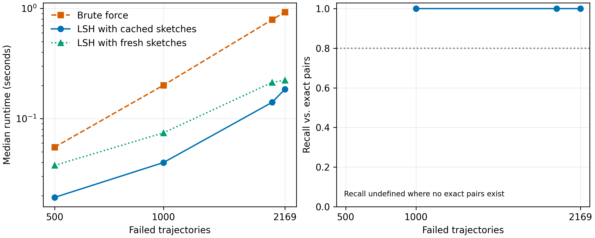

# Doomed in the First Steps?

Phases 5–6 checkpoint

## Executive summary

The reported clustering view identified **1 archetype** covering **26 of 2,169 failed runs**. On all failed runs, LSH recovered **151/151** exact pairs and used 9,748 candidate checks out of 2,351,196 possible pairs.

At **t=20**, LightGBM had the highest mean AUROC (0.666 ± 0.029). The shuffled-label LightGBM control at the same checkpoint scored **0.502 ± 0.033 AUROC** over 3 permutations per fold.

Phase 4 establishes **4 robust patterns**, followed by **13 primary patterns**. The same tasks repeat across submissions, so runs within a task are dependent. The task-clustered check addresses that dependence. BH numbers remain secondary context. [Phase 4 report](phase4_report.md)

## Failure archetypes

The default outcome-augmented 4-gram view found 0 eligible communities at exact Jaccard ≥ 0.60 and minimum membership 20. The reported sensitivity analysis uses collapsed base actions with k=3 at the same threshold and size cutoff. Connected components define communities, with seeded Louvain splitting only for oversized components.

| Community | Failed runs | Framework mix | Mean raw steps |
| --- | --- | --- | --- |
| A01 | 53 | OpenHands 49, SWE-agent 4 | 24.89 |
| A02 | 47 | OpenHands 2, SWE-agent 42, mini-SWE-agent 3 | 25.43 |
| A03 | 45 | OpenHands 4, SWE-agent 41 | 42.44 |
| A04 | 36 | OpenHands 18, SWE-agent 15, mini-SWE-agent 3 | 19.56 |
| A05 | 34 | OpenHands 11, SWE-agent 23 | 23.21 |
| A06 | 27 | OpenHands 1, SWE-agent 25, mini-SWE-agent 1 | 28.85 |
| A07 | 23 | OpenHands 7, SWE-agent 16 | 51.87 |

[Archetype summaries with over-represented shingles and examples](../results/archetypes.csv) · [Membership](../results/archetype_members.csv) · [Manual archetype labels](../results/archetypes_for_labeling.md) · [Representation and k sensitivity](../results/archetype_k_sensitivity.csv)

## MinHash-LSH scaling

The seeded index uses 128 permutations, 32 bands and 4 rows per band. It proposes candidates, and exact Jaccard verifies each edge. Times are medians of 3 runs on nested seeded samples. Both methods start with prepared shingle sets. Fresh LSH includes signature computation, indexing, retrieval, and exact verification. Cached LSH starts from available signatures. The largest sample uses every failed run in the cohort.

| Failed runs | Exact pairs | LSH candidates | Cached LSH s | Fresh LSH s | All-pairs s | Recall |
| --- | --- | --- | --- | --- | --- | --- |
| 500 | 0 | 435 | 0.019 | 0.038 | 0.055 | — |
| 1,000 | 14 | 1,754 | 0.040 | 0.074 | 0.201 | 100.0% |
| 2,000 | 115 | 8,239 | 0.141 | 0.213 | 0.790 | 100.0% |
| 2,169 | 151 | 9,748 | 0.185 | 0.224 | 0.927 | 100.0% |

Recall is undefined for samples with zero exact matches. Empirical log–log runtime slopes over the measured sizes were **1.53** with cached sketches, **1.25** with fresh sketches, and **1.93** for brute force.

[Reported-view benchmark](../results/lsh_scaling.csv) · [Default-view benchmark](../results/lsh_scaling_default.csv) · [datasketch documentation](https://ekzhu.com/datasketch/documentation.html)

## Prefix evaluation cohorts · Deployment view

Each model observes steps 0 through t−1. A run is eligible when its recorded length reaches t. The test columns pool counts across the mutually exclusive outer test tasks. A terminal action can appear inside an eligible prefix and is observable at that checkpoint. Later checkpoints cover fewer runs, so metric changes across checkpoints also reflect cohort selection.

| Checkpoint | Included | Ended earlier | Included failures | Failure rate |
| --- | --- | --- | --- | --- |
| 5 | 4,961 | 4 | 2,168 | 43.70% |
| 10 | 4,711 | 254 | 2,099 | 44.56% |
| 15 | 4,155 | 810 | 1,917 | 46.14% |
| 20 | 3,627 | 1,338 | 1,713 | 47.23% |
| 30 | 2,717 | 2,248 | 1,368 | 50.35% |
| 40 | 2,018 | 2,947 | 1,067 | 52.87% |

[Per-fold and per-partition exclusions](../results/prefix_exclusions_by_fold.csv)

## Held-out model performance

Cells show the mean ± sample standard deviation across 5 outer folds. Failure is the positive class. PR-AUC uses trapezoidal integration. Average precision is available separately in the data. Steps-only LR uses observed character and step-token counts, token-availability and visible submission flags. Recorded per-step token counts were absent. Bag LR uses counts and proportions, LightGBM uses all feature groups, and GRU uses raw prefix tokens. Hyperparameter and early-stopping decisions use grouped inner training tasks. Calibration scores were reserved for the later stopping-policy phase. The optional LLM judge was skipped because no API key was supplied.

### AUROC

| t | Steps-only LR | Bag-of-actions LR | LightGBM | GRU |
| --- | --- | --- | --- | --- |
| 5 | 0.515 ± 0.018 | 0.594 ± 0.019 | 0.617 ± 0.019 | 0.606 ± 0.014 |
| 10 | 0.547 ± 0.025 | 0.620 ± 0.018 | 0.636 ± 0.014 | 0.633 ± 0.022 |
| 15 | 0.559 ± 0.031 | 0.640 ± 0.014 | 0.658 ± 0.013 | 0.629 ± 0.036 |
| 20 | 0.571 ± 0.036 | 0.665 ± 0.026 | 0.666 ± 0.029 | 0.646 ± 0.025 |
| 30 | 0.579 ± 0.028 | 0.679 ± 0.031 | 0.693 ± 0.025 | 0.662 ± 0.037 |
| 40 | 0.600 ± 0.042 | 0.704 ± 0.024 | 0.722 ± 0.029 | 0.696 ± 0.029 |

### PR-AUC

| t | Steps-only LR | Bag-of-actions LR | LightGBM | GRU |
| --- | --- | --- | --- | --- |
| 5 | 0.480 ± 0.053 | 0.545 ± 0.033 | 0.555 ± 0.052 | 0.550 ± 0.048 |
| 10 | 0.507 ± 0.053 | 0.564 ± 0.041 | 0.573 ± 0.044 | 0.582 ± 0.043 |
| 15 | 0.528 ± 0.055 | 0.602 ± 0.048 | 0.615 ± 0.049 | 0.592 ± 0.063 |
| 20 | 0.545 ± 0.051 | 0.627 ± 0.053 | 0.627 ± 0.056 | 0.607 ± 0.055 |
| 30 | 0.581 ± 0.049 | 0.663 ± 0.054 | 0.681 ± 0.037 | 0.652 ± 0.052 |
| 40 | 0.621 ± 0.065 | 0.707 ± 0.053 | 0.745 ± 0.042 | 0.730 ± 0.045 |

[Model metrics](../results/prediction_metrics.csv) · [Fold-level metrics](../results/prediction_fold_metrics.csv) · [Selected hyperparameters](../results/prediction_hyperparameters.csv)

## Shuffled-label control

At t=20, LightGBM refit pattern and archetype references on each shuffled training label vector. Over 3 independent permutations in each outer fold, mean AUROC was **0.502 ± 0.033** and mean PR-AUC was **0.475 ± 0.032** on the original held-out outcomes.

[Control by fold and permutation](../results/shuffled_label_control.csv)

## LightGBM ablation

Each row drops one group and keeps the full model's inner-selected tree settings. Differences are paired within outer folds and take ablated minus full performance. Pattern indicators use up to 50 sequences ranked by absolute training support difference, independent of significance. A fold without a qualifying training archetype supplies a constant similarity feature. Dropping a constant group reuses the full-model score.

| Fold | Patterns | Training archetypes | Inner-training archetypes |
| --- | --- | --- | --- |
| 1 | 50 | 0 | 0 |
| 2 | 50 | 0 | 0 |
| 3 | 50 | 0 | 0 |
| 4 | 50 | 0 | 0 |
| 5 | 50 | 0 | 0 |

| Checkpoint | Dropped | AUROC mean ± SD | PR-AUC mean ± SD | Δ AUROC | Δ PR-AUC |
| --- | --- | --- | --- | --- | --- |
| 5 | archetypes | 0.617 ± 0.019 | 0.555 ± 0.052 | +0.0000 | +0.0000 |
| 5 | bag | 0.612 ± 0.015 | 0.546 ± 0.054 | -0.0053 | -0.0085 |
| 5 | cost | 0.624 ± 0.011 | 0.557 ± 0.043 | +0.0072 | +0.0022 |
| 5 | dynamics | 0.613 ± 0.018 | 0.554 ± 0.050 | -0.0036 | -0.0010 |
| 5 | ngrams | 0.605 ± 0.018 | 0.541 ± 0.050 | -0.0123 | -0.0137 |
| 5 | none | 0.617 ± 0.019 | 0.555 ± 0.052 | +0.0000 | +0.0000 |
| 5 | patterns | 0.616 ± 0.016 | 0.553 ± 0.050 | -0.0007 | -0.0021 |
| 10 | archetypes | 0.636 ± 0.014 | 0.573 ± 0.044 | +0.0000 | +0.0000 |
| 10 | bag | 0.636 ± 0.013 | 0.569 ± 0.047 | +0.0001 | -0.0040 |
| 10 | cost | 0.632 ± 0.009 | 0.572 ± 0.037 | -0.0037 | -0.0002 |
| 10 | dynamics | 0.638 ± 0.013 | 0.575 ± 0.048 | +0.0023 | +0.0022 |
| 10 | ngrams | 0.635 ± 0.009 | 0.575 ± 0.040 | -0.0006 | +0.0022 |
| 10 | none | 0.636 ± 0.014 | 0.573 ± 0.044 | +0.0000 | +0.0000 |
| 10 | patterns | 0.634 ± 0.015 | 0.572 ± 0.046 | -0.0019 | -0.0005 |
| 15 | archetypes | 0.658 ± 0.013 | 0.615 ± 0.049 | +0.0000 | +0.0000 |
| 15 | bag | 0.660 ± 0.015 | 0.613 ± 0.050 | +0.0021 | -0.0020 |
| 15 | cost | 0.654 ± 0.012 | 0.603 ± 0.042 | -0.0046 | -0.0121 |
| 15 | dynamics | 0.655 ± 0.018 | 0.608 ± 0.049 | -0.0033 | -0.0078 |
| 15 | ngrams | 0.650 ± 0.013 | 0.602 ± 0.040 | -0.0084 | -0.0134 |
| 15 | none | 0.658 ± 0.013 | 0.615 ± 0.049 | +0.0000 | +0.0000 |
| 15 | patterns | 0.659 ± 0.013 | 0.615 ± 0.050 | +0.0010 | -0.0008 |
| 20 | archetypes | 0.666 ± 0.029 | 0.627 ± 0.056 | +0.0000 | +0.0000 |
| 20 | bag | 0.658 ± 0.027 | 0.615 ± 0.057 | -0.0073 | -0.0123 |
| 20 | cost | 0.659 ± 0.028 | 0.621 ± 0.051 | -0.0062 | -0.0060 |
| 20 | dynamics | 0.664 ± 0.022 | 0.625 ± 0.053 | -0.0011 | -0.0024 |
| 20 | ngrams | 0.657 ± 0.028 | 0.617 ± 0.055 | -0.0082 | -0.0107 |
| 20 | none | 0.666 ± 0.029 | 0.627 ± 0.056 | +0.0000 | +0.0000 |
| 20 | patterns | 0.667 ± 0.025 | 0.629 ± 0.053 | +0.0010 | +0.0015 |
| 30 | archetypes | 0.693 ± 0.025 | 0.681 ± 0.037 | +0.0000 | +0.0000 |
| 30 | bag | 0.686 ± 0.030 | 0.681 ± 0.038 | -0.0069 | -0.0002 |
| 30 | cost | 0.694 ± 0.025 | 0.684 ± 0.037 | +0.0009 | +0.0029 |
| 30 | dynamics | 0.690 ± 0.030 | 0.679 ± 0.045 | -0.0029 | -0.0029 |
| 30 | ngrams | 0.679 ± 0.027 | 0.668 ± 0.043 | -0.0131 | -0.0135 |
| 30 | none | 0.693 ± 0.025 | 0.681 ± 0.037 | +0.0000 | +0.0000 |
| 30 | patterns | 0.691 ± 0.027 | 0.682 ± 0.039 | -0.0017 | +0.0011 |
| 40 | archetypes | 0.722 ± 0.029 | 0.745 ± 0.042 | +0.0000 | +0.0000 |
| 40 | bag | 0.708 ± 0.027 | 0.737 ± 0.036 | -0.0136 | -0.0083 |
| 40 | cost | 0.720 ± 0.021 | 0.740 ± 0.043 | -0.0018 | -0.0057 |
| 40 | dynamics | 0.722 ± 0.025 | 0.752 ± 0.036 | +0.0003 | +0.0064 |
| 40 | ngrams | 0.724 ± 0.033 | 0.751 ± 0.042 | +0.0019 | +0.0054 |
| 40 | none | 0.722 ± 0.029 | 0.745 ± 0.042 | +0.0000 | +0.0000 |
| 40 | patterns | 0.726 ± 0.031 | 0.748 ± 0.046 | +0.0045 | +0.0025 |

5 of 5 outer training folds had zero qualifying archetypes. The archetype ablation therefore had zero measured change in those folds.

[Ablations](../results/ablation.csv) · [Fold-level ablations](../results/ablation_folds.csv) · [Training-fold references](../results/prediction_fold_references.csv)
