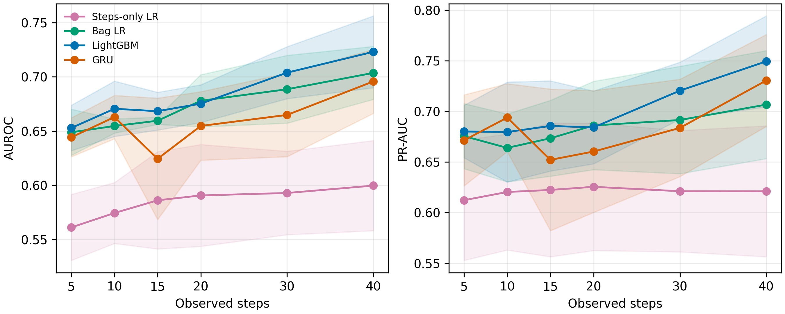
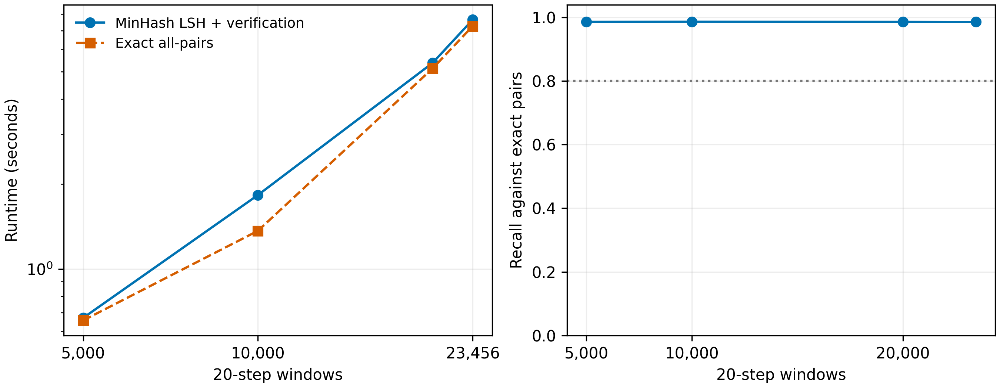

# Doomed in the First Steps?

Phase 8 checkpoint

## Executive summary

The fixed cohort follows **2,018 runs** from 5 to 40 observed steps, with a constant **52.87%** failure rate. This is the how-early comparison. The deployment view includes every run that reaches each checkpoint.

At t=20, LightGBM AUROC was **0.663** overall and **0.709** when comparing successes and failures on the same task. Task difficulty alone cannot account for that within-task discrimination.

The archetype sweep selected **7 communities covering 265 failed runs**. Window LSH recalled **98.57%** on all 23,456 windows.

In grouped evaluation, the multi-checkpoint LightGBM policy saved **5.02%** of character cost at α=0.05 and **9.83%** at α=0.10. Realized false-stop rates were **2.25%** and **4.90%**.

## Fixed cohort · How early is the signal?

Evaluation uses the same runs with at least 40 recorded steps at every checkpoint. Existing models were evaluated on this retrospectively selected cohort. Training used the ordinary checkpoint populations. Cells report mean ± sample SD across five outer test folds. PR-AUC uses trapezoidal integration. The LightGBM rows use revised training-only archetype features.

### AUROC

| t | Runs | Failure rate | Steps-only LR | Bag LR | LightGBM | GRU |
| --- | --- | --- | --- | --- | --- | --- |
| 5 | 2,018 | 52.87% | 0.561 ± 0.030 | 0.649 ± 0.021 | 0.653 ± 0.021 | 0.644 ± 0.018 |
| 10 | 2,018 | 52.87% | 0.574 ± 0.028 | 0.655 ± 0.007 | 0.671 ± 0.026 | 0.663 ± 0.020 |
| 15 | 2,018 | 52.87% | 0.586 ± 0.045 | 0.660 ± 0.003 | 0.668 ± 0.017 | 0.624 ± 0.056 |
| 20 | 2,018 | 52.87% | 0.591 ± 0.047 | 0.678 ± 0.024 | 0.675 ± 0.017 | 0.655 ± 0.032 |
| 30 | 2,018 | 52.87% | 0.593 ± 0.039 | 0.689 ± 0.031 | 0.704 ± 0.024 | 0.665 ± 0.039 |
| 40 | 2,018 | 52.87% | 0.600 ± 0.042 | 0.704 ± 0.024 | 0.723 ± 0.033 | 0.696 ± 0.029 |

### PR-AUC

| t | Runs | Failure rate | Steps-only LR | Bag LR | LightGBM | GRU |
| --- | --- | --- | --- | --- | --- | --- |
| 5 | 2,018 | 52.87% | 0.612 ± 0.059 | 0.676 ± 0.032 | 0.680 ± 0.026 | 0.671 ± 0.045 |
| 10 | 2,018 | 52.87% | 0.620 ± 0.057 | 0.664 ± 0.034 | 0.680 ± 0.049 | 0.694 ± 0.034 |
| 15 | 2,018 | 52.87% | 0.622 ± 0.066 | 0.673 ± 0.037 | 0.686 ± 0.045 | 0.652 ± 0.070 |
| 20 | 2,018 | 52.87% | 0.625 ± 0.063 | 0.686 ± 0.044 | 0.684 ± 0.036 | 0.660 ± 0.060 |
| 30 | 2,018 | 52.87% | 0.621 ± 0.060 | 0.691 ± 0.053 | 0.720 ± 0.028 | 0.684 ± 0.048 |
| 40 | 2,018 | 52.87% | 0.621 ± 0.065 | 0.707 ± 0.053 | 0.749 ± 0.045 | 0.730 ± 0.045 |

## Deployment view · Runs that reach each checkpoint

The failure rate changes with the set of runs still reaching each checkpoint. This view describes deployment eligibility and supports the policy replay below.

### AUROC

| t | Runs | Failure rate | Steps-only LR | Bag LR | LightGBM | GRU |
| --- | --- | --- | --- | --- | --- | --- |
| 5 | 4,961 | 43.70% | 0.515 ± 0.018 | 0.594 ± 0.019 | 0.611 ± 0.018 | 0.606 ± 0.014 |
| 10 | 4,711 | 44.56% | 0.547 ± 0.025 | 0.620 ± 0.018 | 0.637 ± 0.012 | 0.633 ± 0.022 |
| 15 | 4,155 | 46.14% | 0.559 ± 0.031 | 0.640 ± 0.014 | 0.657 ± 0.005 | 0.629 ± 0.036 |
| 20 | 3,627 | 47.23% | 0.571 ± 0.036 | 0.665 ± 0.026 | 0.663 ± 0.025 | 0.646 ± 0.025 |
| 30 | 2,717 | 50.35% | 0.579 ± 0.028 | 0.679 ± 0.031 | 0.690 ± 0.025 | 0.662 ± 0.037 |
| 40 | 2,018 | 52.87% | 0.600 ± 0.042 | 0.704 ± 0.024 | 0.723 ± 0.033 | 0.696 ± 0.029 |

### PR-AUC

| t | Runs | Failure rate | Steps-only LR | Bag LR | LightGBM | GRU |
| --- | --- | --- | --- | --- | --- | --- |
| 5 | 4,961 | 43.70% | 0.480 ± 0.053 | 0.545 ± 0.033 | 0.550 ± 0.052 | 0.550 ± 0.048 |
| 10 | 4,711 | 44.56% | 0.507 ± 0.053 | 0.564 ± 0.041 | 0.571 ± 0.042 | 0.582 ± 0.043 |
| 15 | 4,155 | 46.14% | 0.528 ± 0.055 | 0.602 ± 0.048 | 0.606 ± 0.037 | 0.592 ± 0.063 |
| 20 | 3,627 | 47.23% | 0.545 ± 0.051 | 0.627 ± 0.053 | 0.621 ± 0.049 | 0.607 ± 0.055 |
| 30 | 2,717 | 50.35% | 0.581 ± 0.049 | 0.663 ± 0.054 | 0.677 ± 0.037 | 0.652 ± 0.052 |
| 40 | 2,018 | 52.87% | 0.621 ± 0.065 | 0.707 ± 0.053 | 0.749 ± 0.045 | 0.730 ± 0.045 |

[Fixed-cohort metrics](../results/fixed_cohort_metrics.csv) · [Deployment metrics](../results/deployment_metrics.csv) · [Fixed-cohort prevalence](../results/fixed_cohort_prevalence.csv) · [Deployment prevalence](../results/deployment_prevalence.csv)

## Where LightGBM discriminates

Within-bin and per-framework AUROCs use the revised model on grouped held-out tasks. The same-task diagnostic forms positive-negative pairs only within individual tasks and weights by the number of such pairs in each fold.

| Grouping | Group | t | Runs | AUROC mean ± SD |
| --- | --- | --- | --- | --- |
| difficulty | easy | 5 | 2,432 | 0.670 ± 0.062 |
| difficulty | easy | 10 | 2,244 | 0.710 ± 0.030 |
| difficulty | easy | 20 | 1,584 | 0.733 ± 0.042 |
| difficulty | hard | 5 | 1,577 | 0.611 ± 0.099 |
| difficulty | hard | 10 | 1,535 | 0.620 ± 0.086 |
| difficulty | hard | 20 | 1,276 | 0.644 ± 0.058 |
| difficulty | medium | 5 | 952 | 0.683 ± 0.028 |
| difficulty | medium | 10 | 932 | 0.707 ± 0.012 |
| difficulty | medium | 20 | 767 | 0.707 ± 0.047 |
| framework | OpenHands | 5 | 1,983 | 0.630 ± 0.016 |
| framework | OpenHands | 10 | 1,938 | 0.634 ± 0.029 |
| framework | OpenHands | 20 | 1,598 | 0.634 ± 0.049 |
| framework | SWE-agent | 5 | 1,482 | 0.613 ± 0.024 |
| framework | SWE-agent | 10 | 1,414 | 0.643 ± 0.042 |
| framework | SWE-agent | 20 | 1,150 | 0.703 ± 0.031 |
| framework | mini-SWE-agent | 5 | 1,496 | 0.537 ± 0.023 |
| framework | mini-SWE-agent | 10 | 1,359 | 0.581 ± 0.021 |
| framework | mini-SWE-agent | 20 | 879 | 0.600 ± 0.060 |

| t | Overall AUC | Same-bin AUC | Cross-bin AUC | Same-task AUC | Same-task pairs per fold |
| --- | --- | --- | --- | --- | --- |
| 5 | 0.611 | 0.659 | 0.601 | 0.668 | 1,116.4 |
| 10 | 0.637 | 0.688 | 0.626 | 0.688 | 1,037.8 |
| 20 | 0.663 | 0.702 | 0.655 | 0.709 | 683.8 |

The same-task AUC exceeds the overall AUC at each measured checkpoint, and same-bin discrimination exceeds cross-bin discrimination. The data therefore show substantial discrimination beyond task-difficulty detection. They do not identify a causal share attributable to difficulty. Same-task estimates use tasks with both outcomes, and differences between frameworks and models can remain within those pairs. Difficulty bins are retrospective.

[Subgroup metrics](../results/lightgbm_subgroups.csv) · [Pair decomposition](../results/difficulty_signal.csv)

## Archetype sweep and refit

The sweep uses exact base-action Jaccard graphs on collapsed sequences. It keeps communities of at least 20 runs. The descriptive selection prioritizes the highest threshold that covers at least 5% of failed runs, yields at least two qualifying communities, and puts at most 85% of covered runs in the largest community. Prediction repeats the rule within each training partition, so its settings can differ.

| k | Jaccard cutoff | Communities ≥20 | Failed runs covered | Coverage | Largest community |
| --- | --- | --- | --- | --- | --- |
| 3 | 0.30 | 9 | 888 | 40.94% | 147 |
| 3 | 0.40 | 7 | 265 | 12.22% | 53 |
| 3 | 0.50 | 1 | 161 | 7.42% | 161 |
| 3 | 0.60 | 1 | 26 | 1.20% | 26 |
| 4 | 0.30 | 9 | 375 | 17.29% | 69 |
| 4 | 0.40 | 1 | 103 | 4.75% | 103 |
| 4 | 0.50 | 1 | 51 | 2.35% | 51 |
| 4 | 0.60 | 0 | 0 | 0.00% | 0 |

| Community | Size | Framework mix |
| --- | --- | --- |
| A01 | 53 | OpenHands 49, SWE-agent 4 |
| A02 | 47 | OpenHands 2, SWE-agent 42, mini-SWE-agent 3 |
| A03 | 45 | OpenHands 4, SWE-agent 41 |
| A04 | 36 | OpenHands 18, SWE-agent 15, mini-SWE-agent 3 |
| A05 | 34 | OpenHands 11, SWE-agent 23 |
| A06 | 27 | OpenHands 1, SWE-agent 25, mini-SWE-agent 1 |
| A07 | 23 | OpenHands 7, SWE-agent 16 |

The paired LightGBM refit uses the Phase 6 settings and the same non-archetype features on both sides. Deltas are without minus with archetypes.

| t | With archetypes AUROC | Without archetypes AUROC | Δ AUROC | Δ PR-AUC |
| --- | --- | --- | --- | --- |
| 5 | 0.611 ± 0.018 | 0.617 ± 0.019 | +0.0059 | +0.0046 |
| 10 | 0.637 ± 0.012 | 0.636 ± 0.014 | -0.0010 | +0.0016 |
| 15 | 0.657 ± 0.005 | 0.658 ± 0.013 | +0.0008 | +0.0088 |
| 20 | 0.663 ± 0.025 | 0.666 ± 0.029 | +0.0021 | +0.0062 |
| 30 | 0.690 ± 0.025 | 0.693 ± 0.025 | +0.0026 | +0.0046 |
| 40 | 0.723 ± 0.033 | 0.722 ± 0.029 | -0.0013 | -0.0040 |

[Sweep](../results/archetype_sweep.csv) · [Archetypes](../results/archetypes.csv) · [Manual labels](../results/archetypes_for_labeling.md) · [Training-fold settings](../results/archetype_refit_settings.csv) · [Refit ablation](../results/archetype_ablation_refit.csv)

## Sliding-window scaling

The corpus contains 23,456 full 20-step windows at stride 5, so there are no 40,000 real windows. Seeded nested samples use base-action k=3 and Jaccard ≥ 0.40. LSH timings include sketching, indexing, and exact verification. Identical shingle sets are indexed once while candidate and match counts retain window-pair multiplicities. The compiled exact baseline enumerates the window pairs with valid size and intersection bounds. Benchmarks start with prepared shingle sets.

| Windows | Candidates | Exact pairs | LSH s | Exact s | Recall |
| --- | --- | --- | --- | --- | --- |
| 5,000 | 367,749 | 18,615 | 0.670 | 0.657 | 98.60% |
| 10,000 | 1,398,041 | 69,119 | 1.827 | 1.364 | 98.62% |
| 20,000 | 5,583,976 | 274,430 | 5.374 | 5.138 | 98.60% |
| 23,456 | 7,640,309 | 368,853 | 7.652 | 7.260 | 98.57% |

Exact search completed at every available size within the 10-minute budget. At the larger sample sizes, the compiled exact search was faster despite LSH checking a much smaller candidate set.

[Window scaling data](../results/lsh_window_scaling.csv)

## Phase 7 · Split-conformal policy replay

For each fold and checkpoint, the threshold is the ceiling of (n+1)(1−α) as a one-based order statistic of scores from calibration runs that eventually succeeded and are still continuing. A rank beyond the sample gives an infinite threshold. The policy stops only on a strict exceedance and only when another step remains. The multi-checkpoint policy allocates α/6 to each checkpoint and takes the first crossing.

Character cost is used uniformly because per-step token costs are unavailable. Savings are remaining observed characters divided by total characters across all test runs. Failed-run compute saved uses only savings from failed runs over total failed-run cost. False-stop rates report both all successful runs and the subset eligible for the policy. Wilson intervals are nominal run-level intervals. Repeated tasks limit independence, and distribution shift limits conformal exchangeability.

| α | Policy | Compute saved | Failures caught | All-run false stops [Wilson 95% CI] | Eligible false stops [Wilson 95% CI] | Failed-run compute saved |
| --- | --- | --- | --- | --- | --- | --- |
| 0.05 | All checkpoints | 5.02% | 219 (10.10%) | 63 · 2.25% [1.77%, 2.87%] | 2.27% [1.77%, 2.89%] | 7.62% |
| 0.05 | t=5 | 7.94% | 282 (13.00%) | 140 · 5.01% [4.26%, 5.88%] | 5.03% [4.28%, 5.91%] | 11.37% |
| 0.05 | t=10 | 7.14% | 290 (13.37%) | 138 · 4.94% [4.19%, 5.80%] | 5.41% [4.60%, 6.36%] | 10.05% |
| 0.05 | t=15 | 6.12% | 280 (12.91%) | 106 · 3.79% [3.14%, 4.56%] | 4.90% [4.07%, 5.89%] | 8.81% |
| 0.05 | t=20 | 5.80% | 261 (12.03%) | 109 · 3.90% [3.24%, 4.68%] | 5.90% [4.91%, 7.06%] | 8.31% |
| 0.05 | t=30 | 4.71% | 249 (11.48%) | 75 · 2.68% [2.15%, 3.35%] | 5.71% [4.58%, 7.10%] | 7.13% |
| 0.05 | t=40 | 4.60% | 209 (9.64%) | 30 · 1.07% [0.75%, 1.53%] | 3.27% [2.30%, 4.63%] | 7.59% |
| 0.10 | All checkpoints | 9.83% | 362 (16.69%) | 137 · 4.90% [4.16%, 5.76%] | 4.93% [4.18%, 5.79%] | 14.63% |
| 0.10 | t=5 | 17.66% | 417 (19.23%) | 279 · 9.98% [8.92%, 11.14%] | 10.03% [8.97%, 11.20%] | 25.62% |
| 0.10 | t=10 | 10.98% | 450 (20.75%) | 254 · 9.08% [8.07%, 10.21%] | 9.96% [8.85%, 11.18%] | 14.79% |
| 0.10 | t=15 | 9.93% | 459 (21.16%) | 210 · 7.51% [6.59%, 8.55%] | 9.70% [8.53%, 11.02%] | 13.75% |
| 0.10 | t=20 | 9.38% | 430 (19.82%) | 193 · 6.90% [6.02%, 7.90%] | 10.44% [9.13%, 11.91%] | 13.31% |
| 0.10 | t=30 | 12.75% | 392 (18.07%) | 135 · 4.83% [4.09%, 5.69%] | 10.27% [8.75%, 12.03%] | 20.39% |
| 0.10 | t=40 | 6.43% | 314 (14.48%) | 74 · 2.65% [2.11%, 3.31%] | 8.06% [6.47%, 10.00%] | 10.01% |

[All model policies](../results/early_stop.csv) · [Fold results](../results/early_stop_folds.csv) · [Calibration thresholds](../results/early_stop_thresholds.csv) · [Conformal tutorial](https://arxiv.org/abs/2107.07511)

## Phase 8 · Framework transfer on unseen tasks

Every framework is evaluated on five outer task folds. Training, reference mining, model tuning, and calibration use the two other frameworks on disjoint tasks. The table reports LightGBM transfer. The full file includes all four models.

| Held-out framework | t | AUROC mean ± SD | PR-AUC mean ± SD |
| --- | --- | --- | --- |
| OpenHands | 5 | 0.529 ± 0.038 | 0.438 ± 0.037 |
| OpenHands | 10 | 0.556 ± 0.031 | 0.433 ± 0.054 |
| OpenHands | 15 | 0.544 ± 0.013 | 0.439 ± 0.008 |
| OpenHands | 20 | 0.577 ± 0.020 | 0.487 ± 0.033 |
| OpenHands | 30 | 0.587 ± 0.043 | 0.519 ± 0.061 |
| OpenHands | 40 | 0.569 ± 0.038 | 0.552 ± 0.048 |
| SWE-agent | 5 | 0.517 ± 0.051 | 0.564 ± 0.070 |
| SWE-agent | 10 | 0.553 ± 0.043 | 0.607 ± 0.072 |
| SWE-agent | 15 | 0.593 ± 0.053 | 0.634 ± 0.091 |
| SWE-agent | 20 | 0.622 ± 0.061 | 0.645 ± 0.100 |
| SWE-agent | 30 | 0.592 ± 0.069 | 0.650 ± 0.088 |
| SWE-agent | 40 | 0.708 ± 0.054 | 0.748 ± 0.074 |
| mini-SWE-agent | 5 | 0.504 ± 0.053 | 0.438 ± 0.034 |
| mini-SWE-agent | 10 | 0.516 ± 0.061 | 0.465 ± 0.051 |
| mini-SWE-agent | 15 | 0.520 ± 0.073 | 0.483 ± 0.014 |
| mini-SWE-agent | 20 | 0.535 ± 0.036 | 0.534 ± 0.030 |
| mini-SWE-agent | 30 | 0.552 ± 0.073 | 0.605 ± 0.081 |
| mini-SWE-agent | 40 | 0.589 ± 0.043 | 0.687 ± 0.098 |

### Transfer policy at t=10, t=20, and all checkpoints

| Held-out framework | α | Policy | Compute saved | Failures caught | All-run false stops [Wilson 95% CI] | Eligible false stops [Wilson 95% CI] | Failed-run compute saved |
| --- | --- | --- | --- | --- | --- | --- | --- |
| OpenHands | 0.05 | All checkpoints | 1.46% | 24 (3.10%) | 14 · 1.16% [0.69%, 1.93%] | 1.16% [0.69%, 1.93%] | 2.27% |
| OpenHands | 0.05 | t=10 | 5.10% | 76 (9.83%) | 97 · 8.02% [6.62%, 9.68%] | 8.38% [6.92%, 10.11%] | 5.83% |
| OpenHands | 0.05 | t=20 | 7.76% | 123 (15.91%) | 115 · 9.50% [7.98%, 11.29%] | 12.65% [10.65%, 14.97%] | 9.91% |
| OpenHands | 0.10 | All checkpoints | 4.26% | 69 (8.93%) | 54 · 4.46% [3.44%, 5.78%] | 4.46% [3.44%, 5.78%] | 6.13% |
| OpenHands | 0.10 | t=10 | 11.40% | 161 (20.83%) | 200 · 16.53% [14.54%, 18.73%] | 17.27% [15.20%, 19.56%] | 13.99% |
| OpenHands | 0.10 | t=20 | 17.32% | 275 (35.58%) | 295 · 24.38% [22.04%, 26.88%] | 32.45% [29.49%, 35.57%] | 22.19% |
| SWE-agent | 0.05 | All checkpoints | 0.11% | 2 (0.26%) | 3 · 0.43% [0.15%, 1.25%] | 0.43% [0.15%, 1.25%] | 0.11% |
| SWE-agent | 0.05 | t=10 | 1.02% | 13 (1.67%) | 4 · 0.57% [0.22%, 1.46%] | 0.62% [0.24%, 1.59%] | 1.38% |
| SWE-agent | 0.05 | t=20 | 3.16% | 40 (5.13%) | 19 · 2.71% [1.74%, 4.19%] | 3.79% [2.44%, 5.85%] | 3.92% |
| SWE-agent | 0.10 | All checkpoints | 1.44% | 13 (1.67%) | 15 · 2.14% [1.30%, 3.50%] | 2.14% [1.30%, 3.50%] | 1.36% |
| SWE-agent | 0.10 | t=10 | 8.04% | 87 (11.15%) | 48 · 6.84% [5.20%, 8.95%] | 7.47% [5.68%, 9.76%] | 9.86% |
| SWE-agent | 0.10 | t=20 | 9.17% | 114 (14.62%) | 61 · 8.69% [6.82%, 11.00%] | 12.18% [9.60%, 15.33%] | 11.25% |
| mini-SWE-agent | 0.05 | All checkpoints | 0.31% | 5 (0.81%) | 4 · 0.45% [0.18%, 1.16%] | 0.46% [0.18%, 1.18%] | 0.31% |
| mini-SWE-agent | 0.05 | t=10 | 0.51% | 10 (1.62%) | 6 · 0.68% [0.31%, 1.47%] | 0.80% [0.37%, 1.73%] | 0.62% |
| mini-SWE-agent | 0.05 | t=20 | 0.66% | 18 (2.92%) | 4 · 0.45% [0.18%, 1.16%] | 0.91% [0.35%, 2.32%] | 0.86% |
| mini-SWE-agent | 0.10 | All checkpoints | 1.29% | 15 (2.44%) | 10 · 1.13% [0.62%, 2.07%] | 1.15% [0.63%, 2.10%] | 1.51% |
| mini-SWE-agent | 0.10 | t=10 | 0.96% | 22 (3.57%) | 15 · 1.70% [1.03%, 2.78%] | 2.00% [1.22%, 3.27%] | 1.17% |
| mini-SWE-agent | 0.10 | t=20 | 1.11% | 29 (4.71%) | 11 · 1.24% [0.70%, 2.21%] | 2.51% [1.40%, 4.43%] | 1.39% |

[All transfer metrics](../results/transfer_metrics.csv) · [Transfer policies](../results/transfer_policy.csv) · [Transfer thresholds](../results/transfer_policy_thresholds.csv)

### Pattern overlap

For each framework, patterns are mined from its training tasks and scored on its held-out tasks. The comparison takes up to 30 distinct Fisher-Bonferroni significant patterns per framework, ranked by absolute support difference. The overlap is descriptive and uses each framework's observed list length.

| Framework | Fold-pattern assessments | Distinct significant | Retained |
| --- | --- | --- | --- |
| OpenHands | 40,958 | 13 | 13 |
| SWE-agent | 58,321 | 30 | 30 |
| mini-SWE-agent | 26,377 | 2 | 2 |

| Framework pair | Shared | Union | Jaccard |
| --- | --- | --- | --- |
| OpenHands / SWE-agent | 0 | 43 | 0.000 |
| OpenHands / mini-SWE-agent | 0 | 15 | 0.000 |
| SWE-agent / mini-SWE-agent | 0 | 32 | 0.000 |

Universal patterns in these retained lists · **0**.

[Framework pattern lists](../results/framework_patterns_top30.csv) · [Overlap details](../results/framework_pattern_overlap.csv) · [Pattern spread](../results/framework_pattern_spread.csv)

## Verification

[Test results](../results/phase78_tests.txt) · [Deviations and choices](../DEVIATIONS.md)
